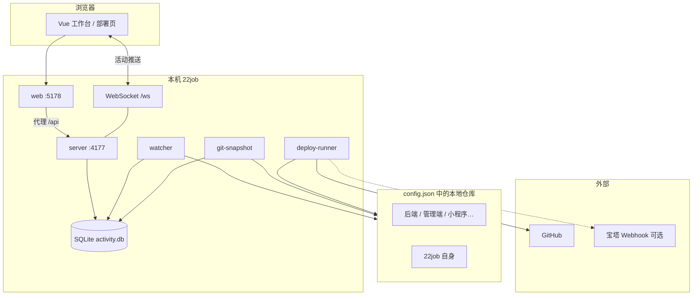
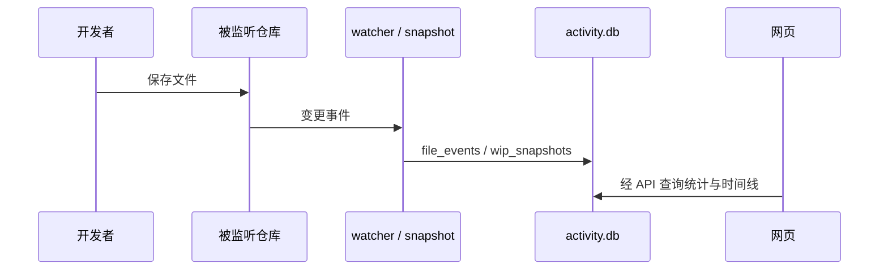
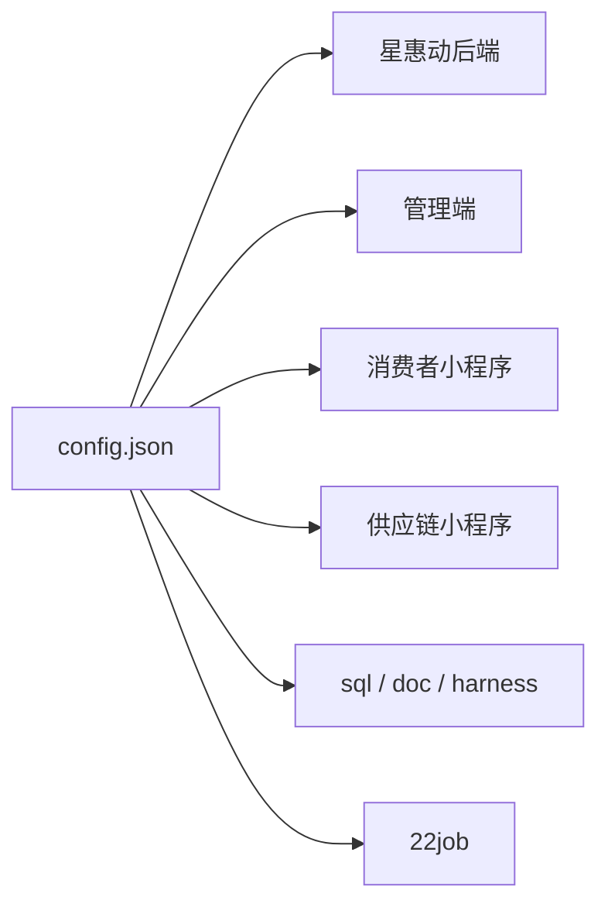

<p align="center">
  
</p>

# 22job · 个人代码工作台

**个人代码活动工作台**：与公司业务仓库分离，整目录可带走。本地监听多仓库改动（含未提交快照）、热力图与时间线、Git 提交汇总，以及一键部署 / GitHub 简介同步。

线上仓库：[zxw6/-](https://github.com/zxw6/-)

<p align="center">
  
</p>

---

## 主要用途

| 能力 | 说明 |
|------|------|
| 活动留痕 | 文件保存即记录；未提交改动按间隔做 WIP 快照（默认 2 分钟） |
| 可视化 | 贡献热力图、活动流、按日文件明细 |
| 多仓监听 | `config.json` 配置多个本地 Git 路径，统一展示 |
| 部署助手 | 先与远程同步 → 再提交 → push，可选宝塔 Webhook |
| GitHub | 简介同步到个人主页仓（默认不覆盖本仓库 README） |

默认端口：**前端 5178**（Vite）、**API **（Fastify）。

---

## 项目结构

```text
22job/
├── package.json                  # dev / tunnel / push
├── config.json                   # 监听的本地仓库列表
├── deploy.json                   # 部署目标、分支、Webhook
├── profile.json                  # 昵称、简介、GitHub 等
├── README.md
├── scripts/
│   ├── git-commit-push.ps1       # 先 commit → rebase → push
│   └── baota-deploy-*.example.*  # 宝塔发布示例
├── server/                       # 后端，127.0.0.1:5178
│   └── src/
│       ├── index.js              # HTTP + WebSocket
│       ├── watcher.js            # 文件保存监听
│       ├── git-snapshot.js       # 未提交 WIP 快照
│       ├── db.js                 # SQLite
│       ├── deploy-*.js           # 部署、草稿、差异、远程
│       └── github-profile-sync.js
├── web/                          # Vue3 + Vite，127.0.0.1:5178
│   └── src/
│       ├── App.vue               # 工作台 / 部署模式
│       ├── views/DeployView.vue
│       └── components/           # 热力图、活动流、设置等
├── data/                         # 本地数据（见 .gitignore）
│   ├── activity.db
│   ├── deploy-drafts/
│   └── github-profile/
└── github-profile/               # GitHub 主页说明与模板
```

---

## 运行时架构



---

## 活动数据流



---

## 监听范围示例

工作台只**读取/监听**下列路径，不替代公司业务仓库本身：



具体路径在本地 `config.json` 中配置，换机器后改路径即可。

---

## 功能模块

| 模块 | 位置 | 作用 |
|------|------|------|
| 活动监听 | `server/src/watcher.js` | 保存事件入库 |
| WIP 快照 | `server/src/git-snapshot.js` | 未提交定时快照 |
| 热力图 | `web/.../ContributionHeatmap.vue` | 按日统计 |
| 活动流 | `web/.../ActivityFeed.vue` | 时间线与日明细 |
| Git 记录 | `git-submissions.js` | 各仓 commit 汇总 |
| 部署 | `DeployView` + `deploy-runner.js` | 提交与推送 |
| GitHub 简介 | `github-profile-sync.js` | 个人主页 README / 头像 |

---

## 快速开始

```bash
# 安装依赖（server、web 各一次）
npm install --prefix server
npm install --prefix web

# 开发：API + 前端
npm run dev
```

浏览器打开：<http://127.0.0.1:5178>

| 命令 | 说明 |
|------|------|
| `npm run dev` | 同时启动   5178 |
| `npm run tunnel` | 构建 + preview，适合 NATAPP 外网访问（请求更少） |
| `npm run push` | 本地有改动则提交，再 `pull --rebase` 后 push |

Windows 也可双击 `start-workbench.bat`。

---

## 与 E:\xhd\code-workbench 的区别

| | **22job（本仓库）** | **xhd/code-workbench** |
|--|---------------------|-------------------------|
| 定位 | 个人完整版，可带走 | 星惠动工作区内的简化版 |
| 数据 | `22job/data` | `xhd/code-workbench/.data` |

**不要同时占用 4177 端口**，否则前端会连错 API，页面会像「数据丢了」。

---

## 仓库与统计

<p align="center">
  
  
</p>

<sub>由代码工作台维护 · 2026</sub>
